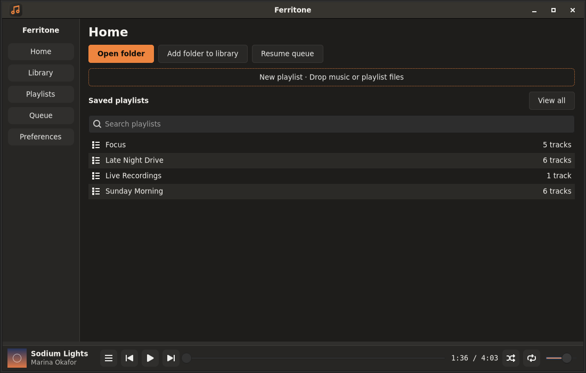

# Ferritone

Ferritone is a Linux desktop music player written in Rust with GTK 4 and libadwaita. It organizes local audio into a searchable library, saved playlists, and a playback queue you can resume after restarting the app.



## Install

On Debian 13 (trixie) amd64, download the `.deb` from the [latest release](https://github.com/ghsantosalves/ferritone/releases/latest) and install it with apt, which also pulls in GTK and GStreamer:

```sh
sudo apt install ./ferritone_0.2.13-1.trixie1_amd64.deb
```

Open **Ferritone** from the application menu. To update, install the `.deb` from a newer release the same way. To uninstall, run `sudo apt remove ferritone`.

On other distributions, download the `.flatpak` file from the same release and install it with `flatpak install --user ./Ferritone-<version>-x86_64.flatpak`, or [build from source](docs/building.md).

## Highlights

- A library of local and synced cloud folders, kept in step with the files, with album and artist pages.
- Drag-and-drop playlists with M3U, M3U8, and PLS import and M3U8 export, and a queue that resumes where you left off.
- Gapless playback, a 10-band equalizer, ReplayGain, a sleep timer, and a mini player with waveforms.
- Synchronized lyrics from `.lrc` files or tags, with an optional [LRCLIB](https://lrclib.net) lookup.
- A [phone remote](docs/remote.md) on your home network, with no internet service in between.
- Optional [ListenBrainz](docs/listenbrainz.md) scrobbling, MPRIS desktop media controls, and a GNOME Shell dock extension.
- Three looks: Ferritone's charcoal and copper, Ferritone in your desktop's colors, or plain GNOME/Adwaita. English, Brazilian Portuguese, Spanish, and French.

Ferritone plays local audio; file format support depends on the installed GStreamer plugins.

## Documentation

- [Using Ferritone](docs/usage.md): pages, queue, shortcuts, sleep timer, audio options, desktop controls, and where data is kept.
- [Lyrics](docs/lyrics.md): local and online lyrics and timing adjustments.
- [Remote control](docs/remote.md): the phone page, playing on the phone, and how access is protected.
- [ListenBrainz](docs/listenbrainz.md): submitting listens and the most played list.
- [Building and packaging](docs/building.md): desktop launcher, Flatpak, Debian package, releases, and the source layout.

## Build

Use Rust 1.85 or later, GTK 4.10 or later, libadwaita 1.7 or later, GStreamer 1.0, a C linker, pkg-config, and the GLib resource compiler. On Debian 13:

```sh
sudo apt install build-essential pkgconf libglib2.0-dev-bin libgtk-4-dev libadwaita-1-dev libgstreamer1.0-dev gstreamer1.0-plugins-base gstreamer1.0-plugins-good
```

Clone the repository, then run Ferritone and its tests.

```sh
git clone https://github.com/ghsantosalves/ferritone.git
cd ferritone
cargo run --locked
cargo test --locked
```

See [Building and packaging](docs/building.md) for the desktop launcher, the Flatpak, and the Debian package.

## License

Copyright © 2026 ghsantosalves.

Ferritone is free software. You may redistribute it or modify it under the terms of the [GNU General Public License, version 3](LICENSE) (`GPL-3.0-only`). Ferritone is distributed without warranty. Third-party dependencies are available under their respective licenses.
